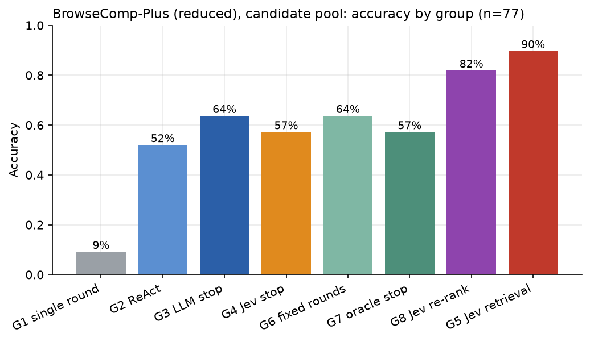
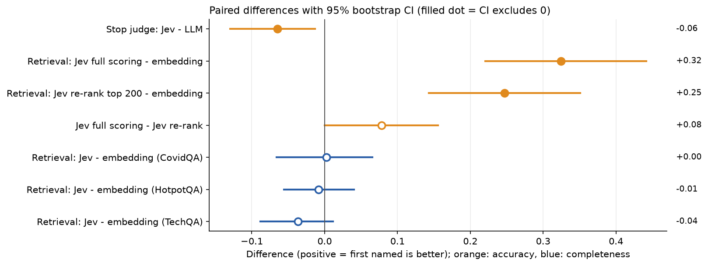

# RAG Search-Flow Comparison: what is Jev worth?

## Summary

Chunking and embedding are fixed; **only the search flow changes**. Eight multi-round RAG flows (G1–G8) are compared on BrowseComp-Plus (reduced, 77 questions) and three RAGBench subsets (66 questions each). The focus is **Jev** (Typesafe `jev-1.13.0`, a cheap per-passage scoring model) in three roles:

| Role | Comparison |
| --- | --- |
| Stop judge | G4 (Jev) vs G3 (LLM) |
| Retriever | G5 (Jev scores every chunk) vs G4 (embedding) |
| Re-ranker | G8 (Jev re-ranks embedding top 200) vs G4 / G5 |

Samples are small and BrowseComp-Plus uses a reduced corpus; treat results as directional (see [docs/DETAILS.md](docs/DETAILS.md#limitations)).

## Key findings

- **Jev retrieval wins big where round-1 retrieval is the bottleneck.** BrowseComp-Plus accuracy 89.6% (G5) vs 57.1% (G4 embedding), +0.32, p < 1e-6, in 1.4 rounds instead of 4.
- **But it is about 23x more expensive** there ($112.6 vs $4.9 per 1k questions, 328 s vs 35 s p50 latency).
- **Jev re-ranking is the best trade-off:** 81.8% accuracy at $18.5 per 1k questions (about 1/6 of G5). Cost per correct answer $0.023 vs $0.126.
- **No gain on RAGBench:** embedding already finds the gold documents; G5 matches it (completeness within ±0.04) at 15–31x the cost.
- **Jev is not a drop-in stop judge:** no quality gain over the LLM judge on any dataset, and its usefulness varies (AUC 0.59 CovidQA, 0.86 HotpotQA).
- **Multi-round search matters most on BrowseComp-Plus:** single round 9% vs 52–64% for multi-round.




Interactive report: [report/ragbench_report.preview.html](report/ragbench_report.preview.html).

## Configuration

**Install** (Python 3.10+):

```bash
python -m venv .venv && source .venv/bin/activate   # Windows: .venv\Scripts\Activate.ps1
pip install -r requirements.txt
python -m pytest tests -q        # offline tests, no API key
python -m ragexp.cli demo        # synthetic demo with fake models
```

**API keys:** `cp .env.example .env` and fill in (git-ignored; real environment variables take precedence).

| Variable | Used for |
| --- | --- |
| `OPENAI_API_KEY` | embeddings (`text-embedding-3-small`) |
| `GLM_API_KEY` | generation, query writing, LLM judge, ReAct (z.ai GLM) |
| `TYPESAFE_API_KEY` | Jev (G4 judge, G5 retrieval, G8 re-rank) |
| `JUDGE_API_KEY` | grading judge |

**Settings** live in [configs/experiment.yaml](configs/experiment.yaml):

| Section | Meaning |
| --- | --- |
| `chunk`, `embed` | 512/64-token chunks; embedding model and your account's `tokens_per_min` limit |
| `index` | `mode: auto` streams the index from disk if it will not fit in RAM |
| `glm`, `judge` | provider, `base_url`, model, `api_key_env`; any OpenAI-compatible endpoint with tool calling works |
| `jev` | pinned model, `req_per_s`, `workers` |
| `search` | `top_k` 5, `e_max` 8k evidence tokens, `r_max` 6 rounds |
| `pricing` | USD per 1M tokens, applied offline (records store tokens, not dollars) |
| `seed`, `dev_fraction`, `test_fraction`, `repeats` | splits and repeats |

**Data** (not in the repo; `raw/`, `data/`, `work/` are git-ignored): put RAGBench `jsonl` splits in `raw/ragbench_<subset>_<split>.jsonl`; for BrowseComp-Plus, decrypt the queries with the official `decrypt_dataset.py` and place `raw/bcp_decrypted.jsonl` and `raw/bcp_corpus.parquet`.

**Run:**

```bash
python -m ragexp.cli convert-ragbench --subset covidqa --out data/covidqa --max-questions 500 raw/ragbench_covidqa_{train,validation,test}.jsonl
python -m ragexp.cli prepare --dataset covidqa --data-dir data/covidqa          # chunk + embed + index (resumable)
python -m ragexp.cli traj    --dataset covidqa --run-id dev --split dev          # shared dev trajectories
python -m ragexp.cli tune    --dataset covidqa --run-id dev                      # tau and R_fixed (dev only)
python -m ragexp.cli groups  --dataset covidqa --run-id final --split test --pool-size 300
python -m ragexp.cli grade   --dataset covidqa --run-id final
python -m ragexp.cli report  --dataset covidqa --run-id final
```

BrowseComp-Plus: `convert-bcp`, then `subset --n 100`. `--limit N` runs a pilot; [scripts/run_experiment.py](scripts/run_experiment.py) chains all steps and resumes after crashes (API calls are cached).

Rough budget: `bcp100` embedding about $1.5, RAGBench about $0.1, G5 about $0.11 per question on a 1,500-chunk pool.

## More

[docs/DETAILS.md](docs/DETAILS.md): flows, full results tables, Jev contributions, limitations. Also [SPEC_REVIEW](docs/SPEC_REVIEW.md) and [PILOT_STATUS](docs/PILOT_STATUS.md).
