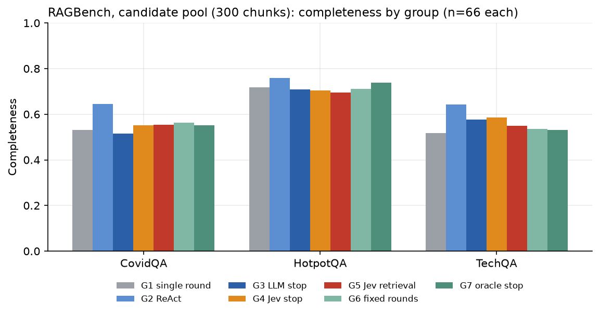
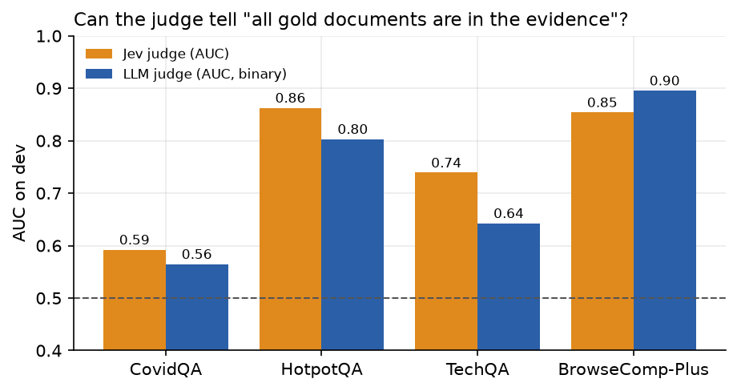

# Details

See the [README](../README.md) for the summary, key findings and configuration.

## Flows

| Group | Flow |
| --- | --- |
| G1 | Single round (top-5 embedding, then answer) |
| G2 | ReAct: GLM calls a `search` tool as needed |
| G3 | Multi-round, LLM sufficiency judge |
| G4 | Multi-round, **Jev** sufficiency judge (threshold tau tuned on dev) |
| G5 | G4 + **Jev scores every candidate chunk** instead of embedding search |
| G6 | Fixed number of rounds (tuned on dev) |
| G7 | Oracle stop when all gold documents are in the evidence (upper bound) |
| G8 | G4 + embedding top-200 **re-ranked by Jev** (BrowseComp-Plus only) |

Datasets: BrowseComp-Plus reduced to 100 questions (corpus = their gold, evidence and hard negatives, 8k documents; metric: accuracy) and RAGBench CovidQA / HotpotQA / TechQA (metrics: completeness and faithfulness, since there are no human gold answers). Each flow runs on the full (reduced) corpus and on a per-question candidate pool (300 chunks RAGBench, 1,500 BrowseComp-Plus); G5 and G8 run only on the pool, and G4-vs-G5 is only fair there.

## BrowseComp-Plus results (candidate pool, n = 77)

| Group | Accuracy | Round-1 recall@5 | Mean rounds | Cost / 1k q | p50 latency |
| --- | --- | --- | --- | --- | --- |
| G1 | 9.1% | 0.08 | 1.0 | $0.6 | 6 s |
| G2 | 51.9% | 0.09 | 3.8 | $4.5 | 30 s |
| G3 | 63.6% | 0.08 | 4.1 | $7.4 | 37 s |
| G4 | 57.1% | 0.08 | 4.0 | $4.9 | 35 s |
| G6 | 63.6% | 0.08 | 6.0 | $6.1 | 29 s |
| G7 | 57.1% | 0.08 | 4.7 | $4.5 | 26 s |
| **G8** | **81.8%** | 0.53 | 1.9 | $18.5 | 11 s* |
| **G5** | **89.6%** | 0.72 | 1.4 | $112.6 | 328 s |

*G8 latency is underestimated (round-1 Jev scores were cached from the G5 run); cost is token-based and unaffected.

Paired accuracy differences: G5 − G4 +0.32 (95% CI +0.22 to +0.44); G8 − G4 +0.25 (+0.14 to +0.35); G5 − G8 +0.08 (0.00 to +0.16, p = 0.11); G4 − G3 −0.06 (−0.13 to −0.01, p = 0.06).

## Jev contributions

1. **Retriever:** per-chunk Jev scoring lifts round-1 recall@5 from 0.08 to 0.72 on BrowseComp-Plus; it only pays off when embedding retrieval is the bottleneck (RAGBench recall@5 is already 0.85–0.97).
2. **Re-ranker:** shortlist with embeddings, re-rank with Jev: most of the gain for about 1/6 of the cost.
3. **Stop judge:** not a drop-in replacement for an LLM; calibration is dataset dependent and a threshold tuned on 19 dev questions is unstable. It also often refuses to stop (56% of CovidQA questions hit `R_max`, vs 10% for the LLM judge).
4. **Cost model for per-passage scoring:** time is bound by the 40 req/s limit, and each request carries about 520 tokens of rubric on top of the chunk, so real cost is about 3x a chunk-tokens-only estimate.
5. **Framework:** only the search flow varies; G3/G4/G6/G7 are replayed offline from one shared trajectory, API calls are hash-cached, the exact index streams from disk, and comparisons use paired bootstrap and McNemar. Total spend for the whole experiment: about $51.

## Limitations

- 66 (RAGBench) and 77 (BrowseComp-Plus) questions; wide CIs, no multiple-comparison correction.
- Reduced BrowseComp-Plus corpus and pools that always contain the answer documents: optimistic and not comparable to the official leaderboard (grading uses `mimo-v2.6-pro`, not Qwen3-32B).
- G5 and G8 were never run on a full 1.7M-chunk corpus.
- Only repeat 1 is graded; G2 (ReAct) has no evidence cap; G6 equals G1 on HotpotQA and TechQA (`R_fixed` = 1).
- The RAGBench judge is stricter than human labels (accuracy 0.76, kappa 0.47 on 150 samples); absolute numbers run low, group comparisons are unaffected.

More: [docs/SPEC_REVIEW.md](SPEC_REVIEW.md) (design decisions), [docs/PILOT_STATUS.md](PILOT_STATUS.md) (pilot log and cost estimates).

## Layout

`ragexp/` core library (clients, chunking, index, retrievers, trajectory/simulation, groups, judges, metrics) · `scripts/` drivers and report/figure builders · `report/` interactive report and data · `runs/final_*/summary.*` aggregated results · `docs/` notes and figures · `tests/` offline tests.
